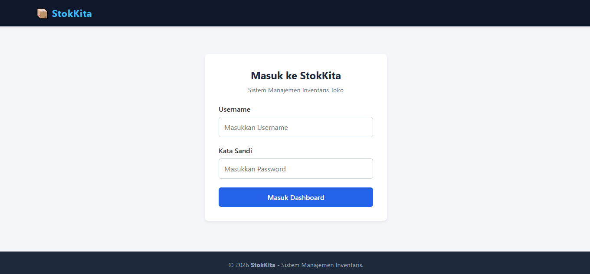
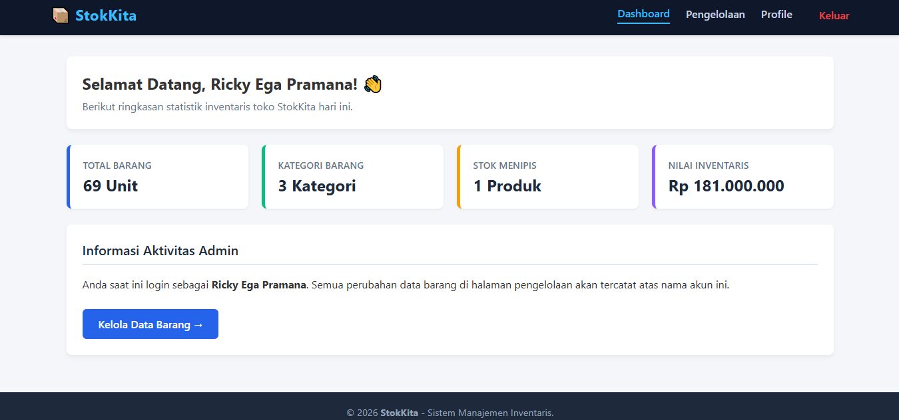
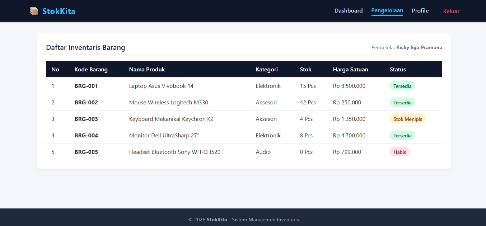
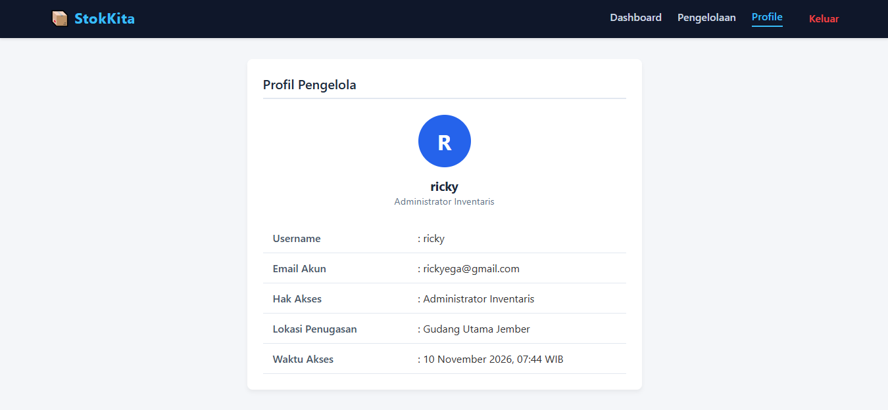

# 📦 StokKita - Sistem Manajemen Inventaris Toko

> **Tugas UTS Pemrograman Berbasis Website**
> **Link Repository GitHub:** `https://github.com/rickyegaa/UTS-PWEB-202410103023`

---

## 👤 Identitas Mahasiswa

- **Nama:** Riki Ega Pramana
- **NIM:** [202410103023]
- **Kelas:** Pemrograman Berbasis Website [D]

---

## 📝 Deskripsi Aplikasi

**StokKita** adalah aplikasi web manajemen inventaris barang toko berbasis framework **Laravel** dengan menerapkan arsitektur **MVC (Model-View-Controller)** murni. Aplikasi ini memproses alur request-response user, menangani parameter `username`, menampilkan alert session status login/logout, serta melakukan rendering dan kalkulasi array statistik data barang secara dinamis pada view menggunakan **Blade Engine**.

### 🔑 Kredensial Akses Akun:

- **Username:** `ricky`
- **Password:** `ricky123`

---

## ✨ Fitur & Keunggulan Utama

1. **Authentication & Security Handling:** Form login yang menangani validasi kredensial `POST` request dengan fitur proteksi `@csrf`.
2. **Flash Alert Session:** Notifikasi alert dinamis saat Login Berhasil (Hijau), Login Gagal (Merah), dan Logout Berhasil (Hijau).
3. **Dynamic Active Navbar:** Navigasi disembunyikan saat di halaman login, dan link navigasi berubah warna (indikator aktif) sesuai halaman yang dibuka.
4. **Calculated Dashboard Stats:** Ringkasan statistik (Total Stok, Jumlah Kategori, Stok Menipis, dan Total Uang Nilai Inventaris) dihitung otomatis dari array data master.
5. **Array Data Rendering:** Halaman Pengelolaan menampilkan list produk inventaris secara lengkap memanfaatkan perulangan Blade `@foreach`.
6. **User Profile:** Halaman profil pengelola yang mengambil initials huruf pertama nama user secara otomatis untuk avatar.

---

## 🖼️ (Screenshots)

### 1. Halaman Login

<p align="center">
  
</p>

---

### 2. Halaman Dashboard

<p align="center">
  
</p>

---

### 3. Halaman Pengelolaan Inventaris

<p align="center">
  
</p>

---

### 4. Halaman Profil Pengguna

<p align="center">
  
</p>

---

## 📂 Struktur File Utama

```text
stokkita/
├── routes/
│   └── web.php
├── app/
│   └── Http/
│       └── Controllers/
│           └── PageController.php
├── screenshots/
│   ├── login.png
│   ├── dashboard.png
│   ├── pengelolaan.png
│   └── profile.png
└── resources/
    └── views/
        ├── layouts/
        │   └── app.blade.php
        ├── components/
        │   ├── navbar.blade.php
        │   └── footer.blade.php
        ├── login.blade.php
        ├── dashboard.blade.php
        ├── pengelolaan.blade.php
        └── profile.blade.php
```
